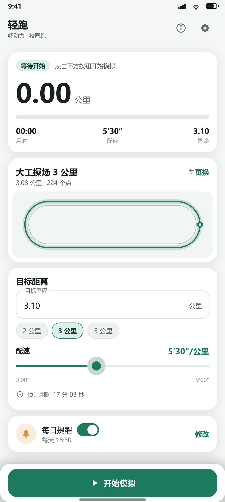

# 轻跑 · FakeRun（畅动力校园跑模拟）

> Fork 自 [LangQi99/dlut-FakeRun](https://github.com/LangQi99/dlut-FakeRun)，围绕大连理工大学「畅动力」校园阳光长跑重做的 2.0 版本：**单屏极简界面 + 更便捷的自定义路径（含地图手绘）+ 每日提醒 + 配速随机浮动**。
>
> [!CAUTION]
> 本项目仅供 Android 开发学习与定位测试使用。请遵守学校规定，不要用于任何违规用途；模拟数据不保证被畅动力判定为有效成绩。

<p align="center">
  
</p>

## 2.0 有什么不一样

### 1. 简约易用的单屏界面
- 一张主页完成所有操作：**状态卡 → 路线卡 → 目标/配速卡 → 每日提醒卡 → 底部开始按钮**。
- 超大里程数字 + 进度条 + 用时/配速/剩余里程，一眼看清当前状态。
- 配速用滑块选择（3'00"–9'00"/km），不再手算 m/s；目标距离用 2/3/5 公里快选或直接输入。
- 开始后按钮自动变成「暂停/继续」，结束按钮独立放置，误触概率更低。
- 深色模式、Material 3 配色，360dp 小屏也不挤。

### 2. 更便捷的自定义路径
支持四种方式，导入后**保存在 App 私有目录的路线库**里，下次直接选：

| 方式 | 说明 |
| --- | --- |
| 地图手绘 | 打开真实地图（OpenStreetMap），双指缩放定位到操场，点着画路线，保存即用 |
| 导入 KML | Google Earth 里画好线 → 导出 KML → 「更换 → 导入文件」 |
| 导入 GPX | 运动手表/其他轨迹 App 导出的 GPX 轨迹 |
| 粘贴坐标 | 每行一个点，`纬度,经度` 或 `经度,纬度` 均可，自动识别顺序 |

另外支持：
- **从文件管理器/聊天软件直接打开** `.kml` / `.gpx` / `.txt`，或分享给轻跑，自动导入并选中；
- 路线库支持删除、当前路线标记；
- **离线路线预览**：主页不依赖地图 SDK，直接把轨迹等比画在卡片里，并显示当前跑到哪；
- 内置「大工操场 3 公里」闭环路线（原版 `three_km.kml`），删掉后会自动补回。

### 3. 配速可在范围内随机浮动
- 主页滑块设定基础配速（3'00"–9'00"/km），到高级设置里可以开启 **±配速浮动**（默认 5%，可调 0–30%）；
- 模拟时速度会在基础配速的 ±X% 范围内平滑随机变化，而不是机械匀速，轨迹、瞬时配速更像真人；
- 填 0 即恢复传统匀速模式。

### 4. 每日提醒
- 主页开关 + 时间选择器，设置每天固定时间提醒；
- 到点通知：「该跑步啦」，点通知直接打开轻跑，通知内还有「一键开始」按钮；
- 适配 Android 12+ 精确闹钟权限（没授权时自动降级为普通闹钟，不崩溃）；
- 重启手机、修改时间/时区后自动恢复提醒（`BOOT_COMPLETED` / `TIME_SET` / `TIMEZONE_CHANGED`）。

### 5. 为畅动力稳定性做的改造
- 模拟循环从前台 Activity 搬到**前台服务**：切到畅动力、锁屏、返回桌面都继续跑；
- 通知栏常驻控制：暂停 / 继续 / 结束，不打断畅动力；
- 唤醒锁保证熄屏后位置持续更新；
- 通知小图标、前台服务类型、Android 13 通知权限、Android 14 前台服务位置权限全部处理；
- 默认 **3.10 公里 / 配速 5'30"**（常见校园跑要求区间内），可在主页随时调整；
- 只有「地图手绘」会联网加载 OpenStreetMap 底图；轨迹与配置数据只保存在本机，不会上传；
- 状态卡实时显示里程/用时/配速，方便对照畅动力界面。

> 地图手绘底图来自 OpenStreetMap（需联网加载地图瓦片，© OpenStreetMap contributors）；轨迹与配置数据只保存在本机。

## 快速开始（真机，推荐 Android 11+）

1. **安装**：从 GitHub Actions 的 `FakeRun-debug-apk` artifact 下载 `app-debug.apk` 安装；或自行构建（见下文）。
2. **开启模拟位置权限**
   - 设置 → 关于手机 → 连点「版本号」开启开发者选项；
   - 设置 → 系统 → 开发者选项 → **选择模拟位置信息应用** → 选择「轻跑」。
3. **打开轻跑**，授予定位权限（Android 13+ 建议同时授予通知权限）。
4. 选路线、目标距离、配速，点 **开始模拟**。
5. 切到 **畅动力** 开始跑步，位置会按路线自动推进；跑完先在畅动力结束，再回轻跑点「结束」。
6. 保持轻跑在后台运行、通知常驻；如系统清理后台，请把轻跑加入电池优化白名单。

> 页面上的「使用说明」也会引导你打开开发者选项。

## 自定义路径详解

### 地图手绘（推荐）
1. 主页「更换 → 地图手绘」；
2. 双指缩放/拖动地图，定位到你的操场（默认定位到当前路线附近）；
3. 沿跑道依次点击，右上角会显示已选点数；点错了可「撤销」，可「清空」；
4. 回到起点附近结束，点「保存并使用」，轻跑会自动把起点补上形成闭环。

### KML（Google Earth）
在 Google Earth 中沿操场画一条闭合路线 → 右键 → 将位置另存为 → 格式选 KML → 在轻跑「更换路线 → 导入文件」选择即可。

### GPX
任何支持导出 GPX 的手表/App（Garmin、小米运动、Strava 等）导出的轨迹都支持，取第一条轨迹的全部点。

### 粘贴坐标
- 从聊天记录/文档复制坐标，例：
  ```
  39.0845,121.8088
  39.0846,121.8089
  ```
- 也支持带第三列海拔、空格分隔、分号分隔；
- 经度大于 90 时自动识别为 `经度,纬度` 顺序（国内坐标都适用）。

## 每日提醒

主页「每日提醒」开关 → 默认每天 18:30 → 点「修改」选择时间。
- Android 12+：首次开启会询问「闹钟和提醒」权限，允许后准点提醒；不允许也能提醒，只是可能被系统延后。
- 重启、改时间、改时区后提醒会自动重排（无需重新打开 App）。
- 小米/红米（HyperOS）、OPPO/一加、vivo、华为/荣耀等系统请额外允许**自启动/后台运行**，否则提醒可能被系统拦截。

## 高级设置

右上角菜单 → 设置：
- **推送间隔**：默认 0.3 秒，越小越平滑但更耗电；
- **海拔**：默认 0 米（部分校园跑不校验）；
- **加速度**：默认 0；
- **配速浮动（±%）**：默认 5%，在基础配速上下随机浮动，让速度更自然；填 0 为匀速；
- **保持屏幕常亮**：模拟时不让屏幕熄灭（默认关闭）。

## 构建

环境：
- JDK 17（Gradle 8.7 / AGP 8.6 要求）
- Android SDK：`compileSdk 34`、`build-tools 34`（`local.properties` 指向 SDK 路径）

```bash
# Debug APK
./gradlew assembleDebug
# 产物：app/build/outputs/apk/debug/app-debug.apk

# 单元测试（纯 JVM：坐标/路线/解析/格式化/提醒时间）
./gradlew testDebugUnitTest
```

本次重构的环境、构建命令、APK 校验值与单测/lint 结果见 [docs/build-report.md](docs/build-report.md)。

仓库自带 GitHub Actions（`.github/workflows/android.yml`）：push 到 main 会自动构建 Debug APK 并上传 artifact，打 `v*` tag 会构建 Release APK 并发布到 Release。

## 项目结构

```
app/src/main/java/com/langqi/fakegps/
├── MainActivity.java          # 单屏主页（状态/路线/目标/提醒/权限引导）
├── RouteSketchActivity.java   # 地图手绘路线编辑器（OpenStreetMap）
├── SimulationService.java     # 前台模拟服务：按配速沿路线推进 + 通知栏控制
├── core/
│   ├── GeoPoint.java          # 坐标
│   ├── GeoMath.java           # Vincenty 距离 / 方位角 / 插值
│   ├── Route.java             # 路线模型与按里程采样（循环）
│   ├── RouteParser.java       # KML / GPX / 文本坐标解析
│   ├── RouteStore.java        # 路线库（JSON 持久化 + 内置路线）
│   ├── MockLocationEngine.java# 测试定位 Provider 注入
│   ├── SimulationConfig.java  # 模拟参数（含配速浮动）
│   ├── AppPrefs.java          # 配置存储
│   └── Formats.java           # 里程/配速/用时格式化
├── reminder/                  # 每日提醒（调度/通知/开机恢复）
│   ├── ReminderScheduler.java
│   ├── ReminderReceiver.java
│   ├── BootReceiver.java
│   └── ReminderTime.java
└── ui/
    ├── RoutePreviewView.java  # 离线路线预览
    └── RouteAdapter.java      # 路线库列表
```

## 常见问题

**Q：点开始后提示「启动失败 / 无法创建模拟定位」？**
A：没有在「开发者选项 → 选择模拟位置信息应用」里选中轻跑。主页会出现授权提示卡，点「去开启」即可。

**Q：畅动力里没有轨迹 / 位置不动？**
A：确认顺序：先在轻跑点开始，再打开畅动力开始跑步；确认轻跑没有被系统杀掉（通知栏应有「模拟跑步中」）；确认定位权限已授予。

**Q：地图手绘打不开地图 / 一片空白？**
A：底图使用 OpenStreetMap 在线瓦片，需要联网且网络能访问 OSM；离线或网络受限时仍可点击画点，但看不到底图。建议导入 KML/GPX 或用内置路线。

**Q：提醒不准时 / 不响？**
A：Android 12+ 需允许「闹钟和提醒」权限；国产 ROM 需允许自启动/后台运行；勿在系统里直接「强制停止」轻跑（会清空闹钟）。

**Q：模拟的跑步成绩会被畅动力判定有效吗？**
A：无法保证。畅动力可能校验步频、轨迹合理性、设备传感器等，本工具只模拟位置（配速浮动只是让速度变化更自然）。仅供学习测试。

## 致谢 / 说明

- 上游项目：[LangQi99/dlut-FakeRun](https://github.com/LangQi99/dlut-FakeRun)，原版内置大工操场路线与模拟定位思路；
- 本项目在 2.0 中重写了界面、路线管理、模拟服务与提醒，目标软件为「畅动力」；
- 地图手绘使用 open source 的 [osmdroid](https://github.com/osmdroid/osmdroid) 加载 OpenStreetMap 瓦片，遵守其使用条款；
- 轨迹与配置数据仅保存在本机。
